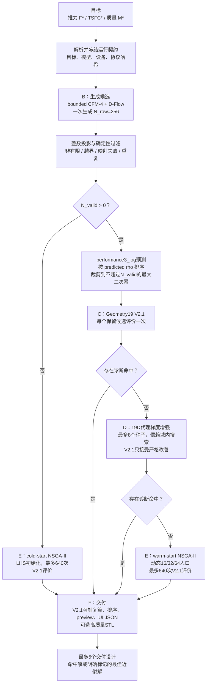
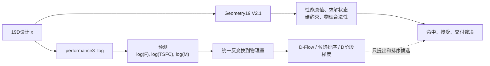
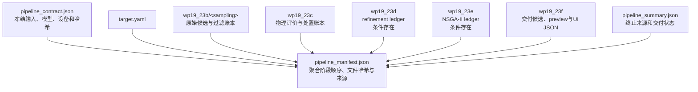

# Geometry19 当前逆设计 Pipeline 与功能说明

> 状态日期：2026-09-27；V3 实现暂停于 `ea1cfc5`，当前整理文档。V3 最新状态、数据与证据索引见 [V3 当前状态](V3_CURRENT_STATUS.md)。
> 适用入口：`scripts/run_wp19_23_pipeline.py`  
> 人工可读的当前系统说明；默认 V2.1 的机器可读协议以 `config/physics/wp19_23_inverse_closure_v1.yaml` 为准。
> 当前数据等级为 `development_bootstrap`，`formal_use_allowed=false`。

## 1. 系统当前能做什么

Geometry19 pipeline 接收目标推力、TSFC 和整机质量，生成19维设计候选，并通过项目内 Geometry19 V2.1 物理链筛选、修正和交付结果。当前默认组合为：

- bounded-sigmoid Geometry19 CFM-4生成器；
- CFM内部的D-Flow source guidance；
- 三输出 `performance3_log/seed_43` 前向代理；
- Geometry19 V2.1真实评价；
- 未命中时的19D代理梯度增强；
- 仍未命中时的warm-start NSGA-II；
- V2.1强制复算、preview mesh和UI JSON交付。

这里的“真实评价”是相对于代理模型而言的项目内低阶物理真值，不等于CFD、台架试验或制造验证。当前结果只能报告 `development_diagnostic_hit`，不能发布正式命中率。

## 2. 主流程



Pipeline 在C或D阶段首次出现至少一个诊断命中后停止继续搜索，但始终进入F阶段复算和交付。没有命中时不会把代理预测伪装成成功，而是交付最佳近似结果并标记 `BEST_APPROXIMATION_NOT_HIT`。

## 3. 各模块职责

| 阶段 | 主要实现 | 输入 | 核心处理 | V2.1调用 | 输出与停止条件 |
|---|---|---|---|---:|---|
| 契约解析 | `geometry19_inverse_contract.py`、`geometry19_forward_model.py` | 目标、CLI参数、YAML协议 | 解析生成器/代理变体，冻结模型和协议哈希 | 否 | `pipeline_contract.json` |
| B 候选生成 | `geometry19_candidates.py` | 三维目标、CFM checkpoint、source seed | direct或D-Flow；生成256个19D候选；整数投影、过滤、代理排序和二次幂裁剪 | 否 | 原始候选、过滤账本、保留候选 |
| C 真值评价 | `geometry19_physics.py` | B阶段保留候选 | Geometry19映射、V2.1计算、命中与约束判断 | 是，每个保留候选一次 | 有命中则转F，否则转D |
| D 梯度增强 | `geometry19_refinement.py` | C阶段最优候选 | 使用同一前向代理优化hit-aligned目标；离散维保持并枚举合法邻域 | 是，仅用于检查候选并接受严格改善 | 有命中则转F，否则转E |
| E 搜索 | `geometry19_nsga2.py` | C/D候选或cold-start LHS | 约束支配的NSGA-II；按失败轴、rho、轴比和、约束违反排序 | 是，最多640次 | 命中或预算结束 |
| F 交付 | `geometry19_delivery.py` | 最后有效阶段的候选 | V2.1复算、schema与硬约束检查、排序、设计存储和可视化数据 | 是 | 最多交付5个设计 |
| 总编排 | `geometry19_pipeline.py` | 全部运行参数 | 条件分支、断点恢复、失败记录、聚合manifest | 间接 | `pipeline_summary.json`、`pipeline_manifest.json` |

阶段脚本可以用于调试和冻结实验复现，但新的设计请求只能使用统一入口。新增运行能力时，入口、编排器和pipeline测试必须同步更新。

## 4. 模型职责边界



### 4.1 默认前向代理：`performance3_log`

- 只输出推力、TSFC和质量的自然对数；
- 统一反变换后计算hit-aligned目标；
- 用于D-Flow、B阶段候选排序和D阶段梯度；
- 不预测45维约束残差；
- 不加载旧可行性模型；
- 无权接受候选或宣布命中。

### 4.2 可选前向代理：`s0`

S0是历史48输出共享代理，继续保留约束损失和可行性软损失，可用 `--forward-model-tag s0` 显式选择。它用于回归、消融和必要的shadow比较，不是当前默认。

### 4.3 唯一最终裁决：V2.1

候选是否合法、工程约束是否满足、是否命中以及梯度候选是否真实改善，都由Geometry19 V2.1及冻结验收契约决定。代理只能降低搜索成本，不能替代这一裁决。

### 4.4 统一物理运行时

默认 V2.1 路径只在编排入口构造一次 `PipelineContext` 和 `PhysicsRuntime`：

```text
run_wp19_23_pipeline
→ build_pipeline_context
→ build_physics_runtime
→ 同一个 PhysicsRuntime 传入 B/C/D/E/F
```

`build_physics_runtime()` 是 schema、calibration、constraint profile、acceptance/operating-point policy 和守恒容差的集中加载入口；`PhysicsRuntime.evaluate()` 是物理评价入口。CLI 先解析模型：默认 `model V2.1` 才加载本节的 profile context；显式 `model V2.2` 进入独立的 V2.2 局部 B–F 适配器；`model V3` 目前只有受控入口，运行时留待 S2。

候选、阶段 summary、`pipeline_contract.json` 和聚合 manifest 记录同一个 `physics_bundle_hash`。任一物理依赖发生变化时，resume 契约不再相同，从而拒绝混用产物。

### 4.5 Pipeline profile registry

[`config/physics/geometry19_pipeline_profiles_v1.yaml`](../../config/physics/geometry19_pipeline_profiles_v1.yaml) 是 V2.1 profile 的注册表。profile 只选择一份完整 protocol，不能单独覆盖 calibration、constraint profile、map 或 solver。选中的 protocol 仍经由同一个 `build_physics_runtime()` 加载。

当前 registry 包含默认 `v2_1`、多项成对 shadow profile 和 `v2_2_development`。CLI 的 profile 默认值仍为 `v2_1`：

```text
--pipeline-profile v2_1
```

CLI 在确定 `model V2.1` 后才构造 `PipelineContext` 并传入 V2.1 编排器；因此 V2.1 生成器/前向模型 choices 与 B–F 使用同一个已解析协议。profile 身份进入该路径的 contract、summary、manifest 和默认产物路径；未注册的 V2.1 profile 在物理 runtime 构造前即被拒绝。`model V2.2` 沿用冻结适配器配置，`model V3` 首版拒绝显式 profile。

### 4.6 V2.2 synthetic-map shadow

Registry 现在额外注册 `v2_2_shadow`，用于合成压气机 map 和变热物性的软件闭环验证。它不是新的默认物理，也不是可交付模式。

```text
--pipeline-profile v2_2_shadow --sampling direct

B 生成并冻结候选
→ 同一 candidate_id/design_hash 用 V2.1 复算
→ 同一 candidate_id/design_hash 用 V2.2 复算
→ paired ledger + shadow summary
→ 结束（禁止 D/E/F、delivery 和 mesh export）
```

V2.2 仍使用 19D schema 和一维质量流量根。压气机保留滑移/Euler 骨架，map 只提供 Euler 功修正、效率和 surge/choke 边界，不会再独立指定压比。工程策略拒绝所有图外查询；诊断策略仅允许 metadata 声明的有限外推，并增大不确定度。

当前 map 为项目内合成的接口测试数据，`formal_use_allowed=false`。变热物性本切片只接入压气机；燃烧室、涡轮和喷管仍为 V2.1 模型，不应将 shadow 差值解读为已验证的 V2.2 精度改善。

### 4.7 V2.2 局部 B–F 交付路径

公开入口可通过 `--model "model V2.2"` 显式选择局部 CFM、D-Flow、代理排序、V2.2 评价、条件梯度增强、局部 NSGA-II 和 F 独立复算。该路径使用独立输出目录，默认模型仍是 V2.1。

V2.2 支持 `--export-mesh`。F 复算通过后，为完全相同的 19D 映射发布 `preview_mesh` 和 `export_mesh`；纯网格发布不会追加未记账的物理调用。搜索账本的 `source_design_hash` 与几何存储的 `design_id` 使用不同哈希域，summary 显式记录二者映射。`--storage-root` 可指定按几何设计 ID 隔离的存储目录，外部资产 manifest 和组件哈希在完成结果恢复时复核。部分运行仍采用“保留现场并停止”，不支持阶段恢复。

V2.2 仍是 development-only，`formal_use_allowed=false`。入口接入与 STL 发布均不表示 CFD、试验、制造或认证验证完成。

2026-09-23 的 S1 改动先解析 `--model`，使 V2.2 不再预构造并丢弃 V2.1 context。历史 V2.2 完成产物可用 `scripts/verify_geometry19_pipeline_artifact.py <output_root>` 只读核验清单与外部资产；该命令不声称旧产物可按当前源码 `--resume`。

当前 V2.2 开发默认先按代理排名评价最多8个 C 候选，未命中再进入 D/E；E 在种群内首个真实命中时停止。该预算经固定12任务开发对照验证，C=8 共83次含F物理调用，旧 C=1 为98次；它不是未知目标的成本保证。见 `V22_C_WINDOW_AND_E_EARLY_STOP_20260922.md`。

2026-09-21 的 GPU 6 端到端网格交付验收已通过，包含一次完整 B–F 运行、两级各12个 STL、零新增调用 resume、组件篡改拒绝和部分运行拒绝。详见 `V22_MESH_DELIVERY_ACCEPTANCE_20260921.md`。

Web UI 的 **V2.2 new design** 模式接收新的推力、TSFC、质量目标，创建独立任务并调用上述 V2.2 pipeline。切换模式时清空旧模型和指标；任务完成并通过运行与网格哈希复核后才显示本次结果。任务状态写入独立目录，服务重启后可查询已完成结果；中断任务明确报告 `interrupted`。历史结果仍可通过只读 API 查看。功能边界见 `GEOMETRY19_UI_CLI_CAPABILITY_MATRIX_20260921.md`。

### 4.8 V3 22D 开发入口

统一 CLI 已接通 `--model "model V3" --pipeline-profile v3_guided_cfm_development`；网页新 V3 作业使用同一 profile。V3 接受完整 22D 开发设计，三个新增物理变量已有计算消费者；默认模型仍为 V2.1。省略 V3 profile 使用原 fixture，`v3_routed_development` 保留 Sobol 顺序评价，`v3_local_cfm_development` 保留无引导 CFM。S0/S1 的占位和 19D 入口描述是历史契约，不能作为现状。

当前 guided 通路：三性能目标 → 55 类 gate 支持掩码/Top-2 → 局部 CFM 与 D-Flow 256 槽 → Ridge 排序、解析筛选及最多 24 个唯一设计 → C 8 次评价 → C 无有效软件命中时 D 最多 8 个种子、24 步连续优化及最多 8 次评价 → C/D 均未命中时 E 评价 B 第 9–16 个 → F 独立复算或无可评分设计空终态。局部半径 0.08，三个整数状态固定；E 没有进化搜索。

软件命中要求三性能各 ±5%；阶段跳过还要求诊断域有效，不能直接使用下文 V2.1 的容差和排名规则。F 在有 rho 的候选中按整机可行、诊断域有效、其他候选分组，组内按 rho/ID 排序；只有整机可行并命中才可为 PASS。

CLI 支持同一身份的封存阶段恢复；源码/配置变化拒绝旧身份。历史只读完整性核验不等于当前代码身份匹配或允许恢复。网页切入 V3 清空目标，点击运行才提交；支持历史显式查看，暂无取消/中断恢复。完整 22D 结果的 3D 为 19D 投影，V3 不支持沿用 V2.1/V2.2 的工程网格导出选项。

最新 98 个开发目标中 95 个 C 命中，3 个 D 自然触发但 D/E/顺序对照均因 `NO_FLOW_MATCH` 未救回；共 951 次后端调用，仅 95 个有可评分结果进行了 F，复算均一致。独立物理验证、工程可行交付和 E 进化搜索未完成，V3 实现按用户决定暂停。命令、资产及证据见 [V3 当前状态](V3_CURRENT_STATUS.md)。

## 5. 命中度量与排序

本节及后续默认项描述 V2.1。V3 的 5% 容差、整数固定、F 分组、候选预算和恢复规则见 4.8 节，不将版本规则混用。

三个目标轴先计算相对误差，再除以各自开发验收容差：

```text
r_i = relative_error_i / tolerance_i
rho = max(r_thrust, r_TSFC, r_mass)
```

`rho <= 1` 与“三个轴全部在容差内”完全等价。代理阶段使用平滑最大轴比获得可导目标；真实阶段依次比较失败目标轴数量、`rho`、三个轴比之和、工程约束违反量和稳定候选标识。

当前开发容差来自冻结协议：

| 性能轴 | 相对容差 |
|---|---:|
| 推力 | 2.7451% |
| TSFC | 0.8573% |
| 质量 | 1.1707% |

这些数值用于开发对比，不应解释为已通过工程论证的正式验收指标。旧 `total_true_error` 只用于兼容报告，不再主导搜索。

## 6. 默认项、可选项与触发条件

| 功能 | 当前默认 | 可选值/行为 | 说明 |
|---|---|---|---|
| 生成器 | `bounded-sigmoid` | `baseline` | baseline仅用于显式回归或消融 |
| 采样方式 | `dflow` | `direct` | 两者互斥，每次只交付一组最终候选 |
| 前向代理 | `performance3_log` | `s0` | 从同一模型契约解析 |
| 原始候选数 | 256 | 协议冻结 | 只调用生成器一次，禁止refill和复制 |
| 整数维处理 | 无条件最近整数投影 | 无 | 使用 `numpy.rint`，半整数nearest-even |
| D阶段 | C阶段无命中时触发 | 可因C命中跳过 | 最多8个种子 |
| E阶段 | D阶段仍无命中时warm-start | `N_valid=0` 时cold-start | 最大640次物理评价 |
| F阶段 | 始终执行 | 可选高质量STL | 最多交付5个设计 |
| 断点恢复 | 关闭 | `--resume` | 参数或契约改变时拒绝恢复 |

梯度增强和NSGA-II没有从架构中省略；它们是按真实命中状态触发的救援阶段，而不是每次无条件执行。

## 7. 输入与运行方式

目标可通过YAML文件传入，也可以在命令行同时给出三个性能值，两种方式不能混用。

### 7.1 使用当前默认配置

```bash
CUDA_DEVICE_ORDER=PCI_BUS_ID CUDA_VISIBLE_DEVICES=6 \
conda run -n inverse_design_nova \
python scripts/run_wp19_23_pipeline.py \
  --thrust-N 16.240269568822608 \
  --tsfc-kg-N-s 0.0001583899410074742 \
  --mass-kg 2.010229994741361 \
  --device cuda:0
```

省略变体参数时，从协议解析为：

```text
generator = bounded-sigmoid
sampling = dflow
forward surrogate = performance3_log
```

### 7.2 使用目标文件

```bash
python scripts/run_wp19_23_pipeline.py \
  --target path/to/target.yaml \
  --device cuda:0
```

### 7.3 复现S0分支

```bash
python scripts/run_wp19_23_pipeline.py \
  --target path/to/target.yaml \
  --forward-model-tag s0 \
  --device cuda:0
```

### 7.4 常用运行控制

| 参数 | 作用 |
|---|---|
| `--model-variant baseline` | 使用历史无界生成器 |
| `--sampling direct` | 关闭D-Flow source guidance |
| `--refinement-device ...` | 为D阶段单独指定设备 |
| `--output-root ...` | 指定独立运行目录 |
| `--storage-root ...` | 指定交付设计存储目录 |
| `--export-mesh` / `--export-stl` | 生成高质量组件STL |
| `--resume` | 从已完成阶段继续，严格校验原运行契约 |

默认运行目录为：

```text
data/inverse_design/wp19_23_pipeline_v1/
└── <target_id>/<generator_variant>/<forward_model_tag>/
```

运行目录已存在且未传入 `--resume` 时，pipeline拒绝覆盖。

## 8. 产物与审计关系



| 文件/目录 | 用途 |
|---|---|
| `pipeline_contract.json` | 固定目标、模型变体、checkpoint/normalizer哈希、设备、采样方式和协议 |
| `pipeline_summary.json` | 汇总实际执行阶段、终止来源、交付状态和design ID |
| `pipeline_manifest.json` | 聚合已执行阶段的必需文件、SHA-256、字节数和代码来源 |
| `pipeline_failure.json` | 失败时记录已完成阶段、异常类型和消息 |
| `raw_candidates.jsonl`、`candidate_filter_ledger.jsonl` | 原始生成候选及投影、过滤、淘汰原因 |
| `physics_forward_ledger.jsonl` | V2.1评价记录 |
| `candidate_disposition_ledger.jsonl` | 候选的交付、转交或淘汰原因 |
| `refinement_ledger.jsonl`、`nsga2_ledger.jsonl` | D/E阶段搜索账本 |
| `delivered_candidates.json`、`ui_candidates/` | 最终交付设计及UI资产 |
| `export_mesh/` | 显式请求时生成的高质量STL |

## 9. 当前实测证据

在冻结的24目标开发套件上，保持生成器、目标、物理判据和搜索预算不变，仅比较前向代理：

| 指标 | S0 | `performance3_log` |
|---|---:|---:|
| 最终诊断命中 | 21/24 | 23/24 |
| C阶段命中 | 11 | 14 |
| D阶段救回 | 1 | 3 |
| E阶段救回 | 9 | 6 |
| 搜索V2.1调用 | 7413 | 5796 |
| 平均生成合法率 | 96.14% | 95.77% |
| 最终最佳真值rho中位数 | 0.862 | 0.679 |

该结果支持把三维性能代理用于性能引导，并将合法性和约束完全交给V2.1；同时搜索V2.1调用减少21.8%。但只有两个不一致配对，配对精确检验 `p=0.5`，因此证据应表述为“工程上有利、统计上尚未充分确认”，不能把23/24外推为总体正式命中率。

## 10. 当前能力边界

| 维度 | 当前状态 | 与实际应用的差距 |
|---|---|---|
| 参数化 | 19D冻结schema，含连续和离散变量 | 未覆盖完整叶型、流道曲面、公差和装配细节 |
| 生成模型 | 可条件生成19D候选，默认有界输出 | 只在开发数据分布和冻结目标契约内验证 |
| 前向代理 | 快速预测三维性能，支持梯度和排序 | 无法独立裁决；稀疏区仍需重点监控 |
| 物理评价 | Geometry19 V2.1 + mass model V2 | 不替代CFD、FEA、燃烧仿真或试验 |
| 合法性 | schema、映射、数值硬约束和V2.1检查 | 不等同完整可制造性、寿命、安全和认证审查 |
| 几何交付 | preview、UI JSON和可选组件STL | 没有生产级STEP/B-Rep、尺寸标注和制造工艺包 |
| 命中口径 | 冻结开发容差和诊断命中 | 正式容差、独立数据、外部真值和统计置信度尚未闭环 |

## 11. 使用与维护规则

1. `config/physics/wp19_23_inverse_closure_v1.yaml` 是模型、容差、预算和职责的唯一机器可读权威。
2. `scripts/run_wp19_23_pipeline.py` 是唯一公开入口；阶段脚本只用于调试、审计和复现。
3. 代理模型不得直接接受候选、替代V2.1命中判断或隐藏失败。
4. 修改生成器、代理、输出变换或职责时，必须更新契约、模型哈希记录和测试。
5. 新增pipeline能力时，入口、`src/ai/geometry19_pipeline.py`、`tests/test_geometry19_pipeline.py`和入口说明必须同步。
6. 历史实验文档保留当时语义；当前行为以本文件、入口说明和机器契约为准。

## 12. 相关文档

- `WP19_23_PIPELINE_ENTRYPOINT.md`：入口同步规则与实现级运行语义。
- `WP19_23_PERFORMANCE3_FULL_PIPELINE_COMPARISON_20260908.md`：`performance3_log`替换S0的实验依据。
- `WP19_23_INVERSE_CLOSURE_20260827.md`：逆设计闭环阶段验收记录。
- `NovaTurbo_GeometryAware_19D_Closed_LowOrder_Engine_Model_V2_1.md`：Geometry19 V2.1低阶物理模型说明。
